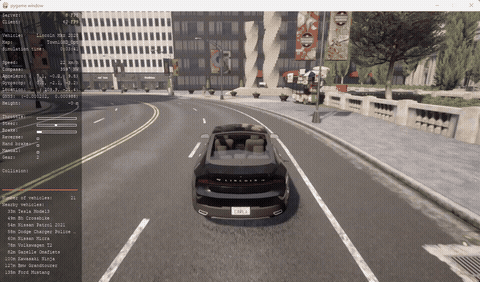
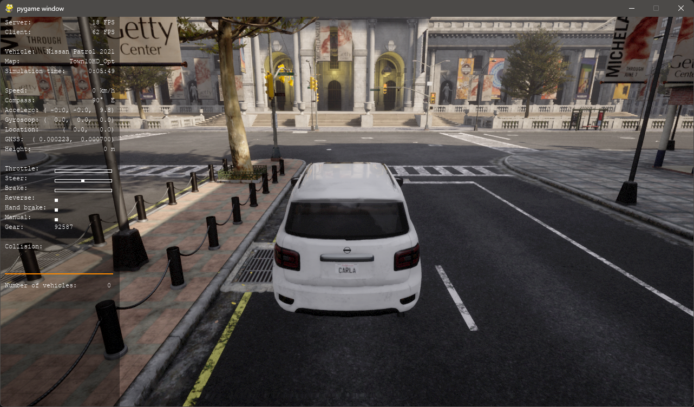
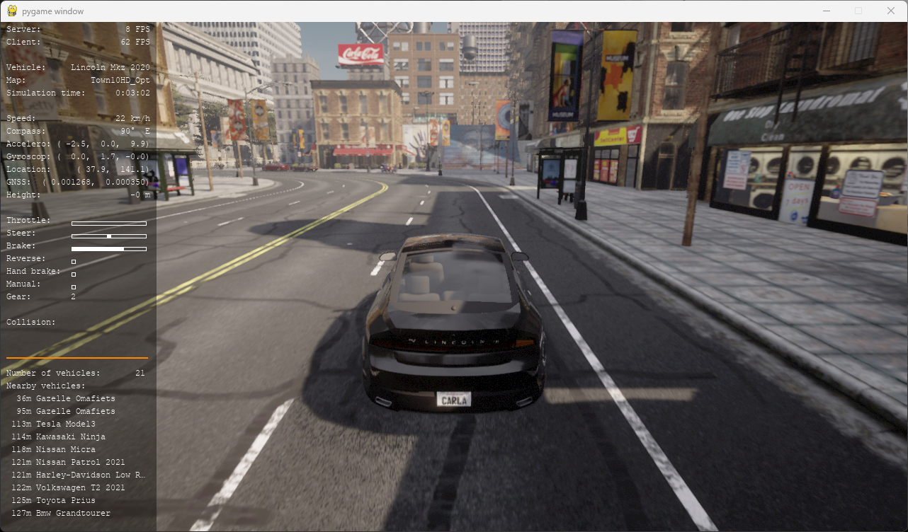
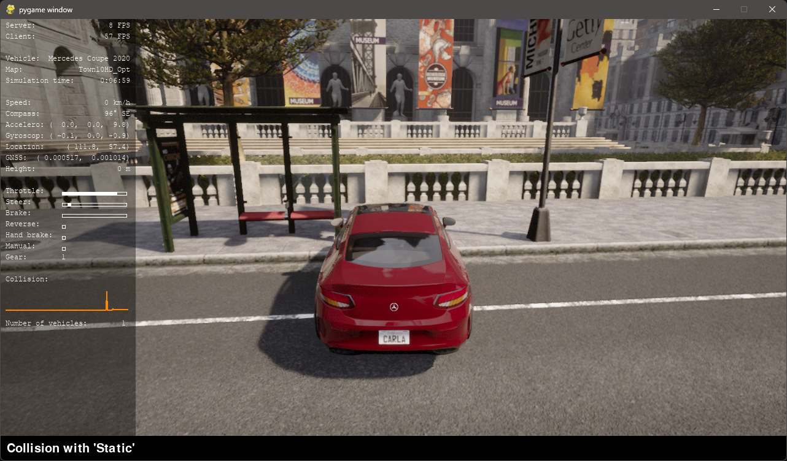

# AI-Based Autonomous Driving Using Behavioral Cloning

Collect human driving data in CARLA, train a CNN to predict steering, and compare **baseline vs. augmented** training.



## Results at a glance

| Metric | Baseline | Augmented |
|---|---|---|
| Test MAE (steering) | 0.0124 | 0.0131 |
| Test MSE (steering) | 0.00073 | 0.00072 |
| Autonomous drive distance (300 frames) | 93.2 m | 88.9 m |
| Autonomous drive collisions (300 frames) | 0 | 0 |
| Autonomous drive lane invasions (300 frames) | 9 | 4 |
| Avg speed (km/h) | 22.4 | 21.4 |
| Steering smoothness (MAD) | 0.0123 | 0.0191 |

Augmentation improved offline accuracy but the baseline drove slightly better online — a classic behavioral-cloning finding.

## Dashboard



```bash
streamlit run app/dashboard.py
```

## 3D Visualization



```bash
python -m src.visualize_3d
```

## Training Curves



## Setup

```bash
conda create -n carla python=3.12 -y
conda activate carla
pip install PythonAPI/carla/dist/carla-0.9.16-cp312-cp312-win_amd64.whl
pip install -r requirements.txt
```

## Run

### 1. Launch CARLA
```bash
CarlaUE4.exe
```

### 2. Collect data (pick one)

**Manual (you drive):**
```bash
python PythonAPI/examples/generate_traffic.py -n 20
python PythonAPI/examples/manual_control.py
python -m src.collect_data --mode manual --frames 5000 --out data/collected
```

**Autopilot (automated expert):**
```bash
python -m src.collect_data --mode autopilot --frames 5000 --out data/collected --traffic 20
```

### 3. Train
```bash
python -m src.train --data data/collected --experiment baseline --epochs 30
python -m src.train --data data/collected --experiment augmented --augment --epochs 30
```

### 4. Evaluate
```bash
python -m src.evaluate --model models/baseline/model.keras --data data/collected
python -m src.evaluate --model models/augmented/model.keras --data data/collected
```

### 5. Autonomous driving
```bash
python -m src.drive --model models/augmented/model.keras --frames 300
```

### Smoke test (no CARLA)
```bash
python run_pipeline.py
python -m pytest -q
```

## Project structure

```
config.py              paths & hyperparameters
src/
  carla_client.py      CARLA connection & sensors
  collect_data.py      manual + autopilot collection
  preprocess.py        crop/resize/normalize + augmentation
  model.py             NVIDIA CNN + variants
  train.py             baseline/augmented training
  evaluate.py          metrics + plots
  drive.py             autonomous inference
  metrics.py           KPIs
  tune.py              hyperparameter tuning
  rl_baseline.py       DQN baseline
  visualize_3d.py      3D visualization
app/dashboard.py       Streamlit dashboard
tests/                 pytest smoke tests
```

## Tech stack

CARLA 0.9.16 · Python 3.12 · TensorFlow/Keras · OpenCV · NumPy · Pandas · Matplotlib · Plotly · Streamlit

## Notes

- Training data, models, logs, and reports are gitignored (local only).
- GPU not used on native Windows (TF ≥2.11); CPU training is fast enough.
- Manual labels have ~1 tick delay (see code comments).
- Augmented model: slightly worse offline MAE but fewer lane invasions online.
- Both models: 0 collisions over 300 frames on Town10HD at ~22 km/h.

## Git

Source code, tests, and docs are on GitHub (`feature/behavioral-cloning` branch). Generated data/models/logs stay local.