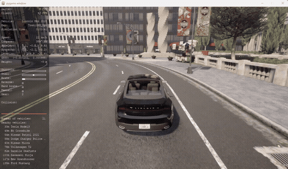
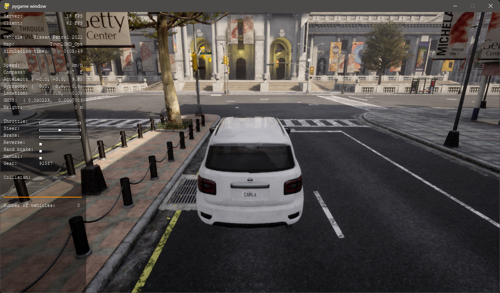
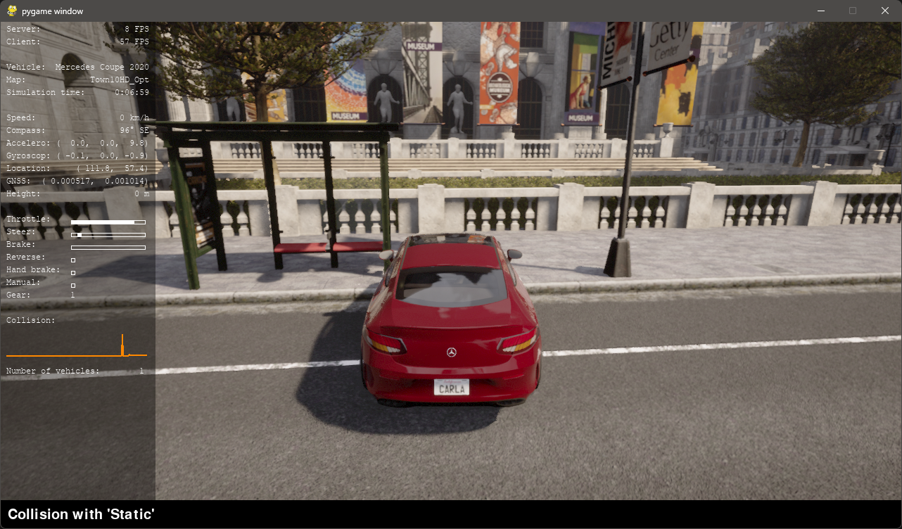
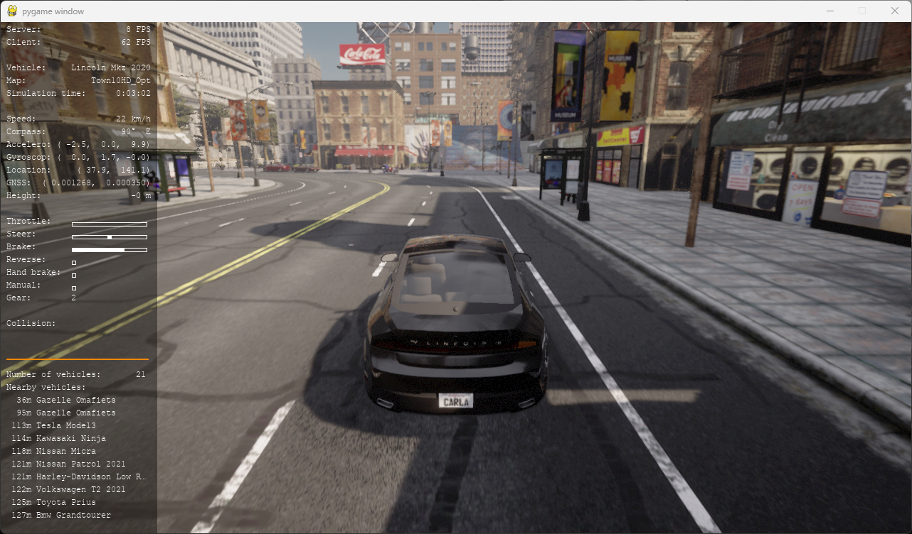
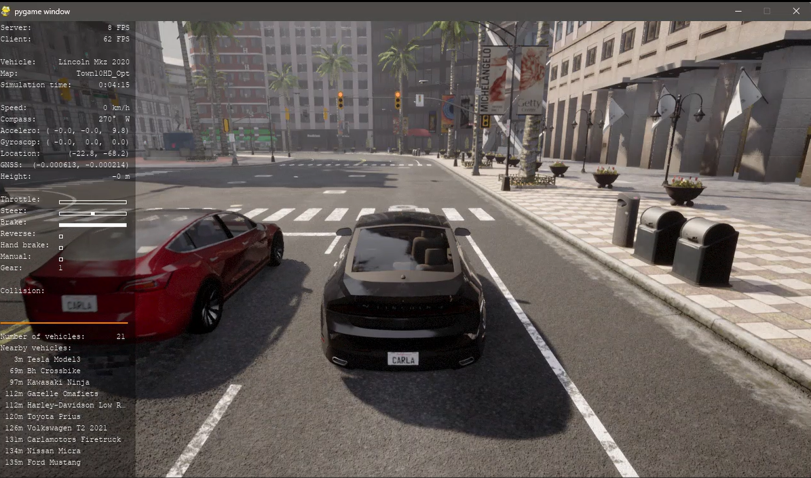

# AutoCar-Sim

**A CARLA-based autonomous driving simulation and behavioral cloning research project.**

AutoCar-Sim explores autonomous vehicle control using deep learning and simulated driving data. Built on the CARLA simulator, it collects driving demonstrations, trains convolutional neural networks to predict steering behaviour, and evaluates trained models in simulated driving environments.

The project also includes a Streamlit dashboard for exploring training results, model performance, and driving metrics.



## Overview

AutoCar-Sim follows an end-to-end machine learning workflow:

1. **Data collection:** Capture driving observations and control information using manual driving or CARLA autopilot.
2. **Preprocessing:** Prepare camera images and driving labels for model training.
3. **Model training:** Train CNN-based steering prediction models using behavioral cloning.
4. **Evaluation:** Measure prediction accuracy and examine performance on held-out driving data.
5. **Autonomous driving:** Load a trained model and test its driving behaviour in CARLA.
6. **Visualization:** Explore results using the Streamlit dashboard and 3D visualizations.

## Features

- Manual and autopilot driving-data collection.
- Camera-based steering prediction using convolutional neural networks.
- Baseline and data-augmentation experiments.
- RGB and depth-based sensor input.
- Dataset splitting designed to reduce leakage between adjacent frames.
- Model evaluation using held-out samples.
- Autonomous driving experiments inside CARLA.
- Driving metrics and benchmark comparisons.
- Interactive Streamlit dashboard.
- 3D visualization of simulation results.
- Synthetic-data pipeline for testing without a running CARLA instance.

## Dashboard

The Streamlit dashboard provides an overview of the available datasets, training experiments, evaluation results, and driving metrics.



Launch it locally:

```bash
streamlit run app/dashboard.py
```

## Training and Visualization

### Training results



### 3D visualization



### Autonomous driving



## Technology Stack

| Area | Technologies |
|---|---|
| Simulation | CARLA 0.9.16 |
| Programming | Python 3.12 |
| Deep Learning | TensorFlow, Keras |
| Computer Vision | OpenCV |
| Data Processing | NumPy, Pandas, Scikit-learn |
| Visualization | Matplotlib, Plotly |
| Dashboard | Streamlit |
| Testing | Pytest |

## Getting Started

### Requirements

- Python 3.12
- CARLA 0.9.16 for simulator-based experiments
- A compatible CARLA Python API package
- TensorFlow and the dependencies listed in the project requirements
- A system capable of running the CARLA simulator

The lightweight dashboard and synthetic-data workflow can be used separately from a live CARLA simulation.

### 1. Clone the repository

```bash
git clone https://github.com/xt67/AutoCar-Sim.git
cd AutoCar-Sim
```

### 2. Set up the Python environment

Using Conda:

```bash
conda create -n autocar python=3.12 -y
conda activate autocar
```

Install the CARLA Python API package matching your CARLA installation and Python environment.

For CARLA 0.9.16 on Windows, the project setup uses:

```bash
pip install PythonAPI/carla/dist/carla-0.9.16-cp312-cp312-win_amd64.whl
```

Install the full project dependencies:

```bash
pip install -r requirements-full.txt -c requirements-test.txt
```

For the dashboard-only environment:

```bash
pip install -r requirements.txt
```

### 3. Start CARLA

Launch the CARLA simulator.

On Windows:

```bash
CarlaUE4.exe
```

On Linux:

```bash
./CarlaUE4.sh
```

### 4. Collect driving data

AutoCar-Sim supports two collection modes.

**Manual driving:**

```bash
python -m src.collect_data --mode manual --frames 5000 --out data/collected
```

**CARLA autopilot:**

```bash
python -m src.collect_data --mode autopilot --frames 5000 --out data/collected --traffic 20
```

Use a new output directory for each collection session. The collection process does not overwrite an existing telemetry file.

### 5. Train the models

Train a baseline model:

```bash
python -m src.train --data data/collected --experiment baseline --epochs 30
```

Train an augmented model:

```bash
python -m src.train --data data/collected --experiment augmented --augment --epochs 30
```

### 6. Evaluate a trained model

```bash
python -m src.evaluate --model models/baseline/model.keras --data data/collected
```

Evaluation uses the saved dataset split associated with the model by default. For a separate external dataset, use the explicit `--external-dataset` option.

### 7. Run autonomous driving

```bash
python -m src.drive --model models/baseline/model.keras --frames 300
```

### 8. Launch the dashboard

```bash
streamlit run app/dashboard.py
```

Open the local Streamlit address shown in your terminal, usually:

```text
http://localhost:8501
```

## Quick Pipeline Test

A synthetic-data workflow is available for testing the training pipeline without launching CARLA.

```bash
python run_pipeline.py
```

Run the test suite:

```bash
python -m pytest tests -q
```

## Project Structure

```text
AutoCar-Sim/
│
├── app/
│   └── dashboard.py
│
├── src/
│   ├── carla_client.py
│   ├── collect_data.py
│   ├── dataset.py
│   ├── preprocess.py
│   ├── model.py
│   ├── train.py
│   ├── evaluate.py
│   ├── drive.py
│   ├── metrics.py
│   ├── benchmark.py
│   ├── tune.py
│   ├── rl_baseline.py
│   ├── synthetic_data.py
│   └── visualize_3d.py
│
├── data/
├── models/
├── logs/
├── reports/
│
├── docs/
│   ├── images/
│   ├── validation/
│   └── videos/
│
├── tests/
├── config.py
├── requirements.txt
├── requirements-full.txt
├── requirements-test.txt
├── run_all.py
├── run_pipeline.py
├── Dockerfile
└── README.md
```

## Evaluation and Current Limitations

Autonomous driving performance is evaluated separately from offline steering-prediction accuracy. A model with good prediction metrics does not necessarily demonstrate reliable driving in a simulated environment.

The latest CARLA validation compared the original baseline and augmented checkpoints across three short runs each, using 300 frames per run without traffic.

| Model | Completed runs | Collision-flagged frames |
|---|---:|---:|
| Baseline | 3 / 3 | 0 across all runs |
| Augmented | 0 / 3 | 130–183 per run |

These results make the baseline the better candidate for a limited demonstration. The augmented checkpoint did not perform reliably in the latest evaluation.

This benchmark is limited in duration and environment coverage. It does not establish real-world driving readiness or generalization across different traffic and weather conditions.

For the measured results and methodology, see the [project validation review](PROJECT_REVIEW.md) and [raw CARLA benchmark data](docs/validation/carla-20261111.json).

## License

This project is distributed under the MIT License. See [LICENSE](LICENSE) for details.

CARLA and other third-party software, datasets, and assets remain subject to their respective licenses and terms.
